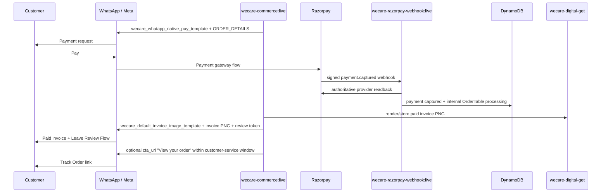

# WhatsApp Payment Collection — Canonical Stack

**Status:** PRODUCTION SIGNED-OFF / FROZEN — source of truth for the WECARE.DIGITAL WhatsApp payment rail  
**Last audited:** 2026-10-26  
**Region:** `us-east-1`  
**Primary payment WABA:** `2094615664435155`

This document defines the canonical customer journey, runtime ownership, persistence, retry rules,
templates, media, catalog aliases, and the files that must be updated together when the payment rail
changes. Treat contradictions in older execution notes as historical snapshots.

## 0. Production sign-off and freeze

The payment rail was production signed-off on **2026-10-26** with a fresh real Razorpay payment:

- reference: `WD-PAY-A18274BA`
- invoice: `WD/2627/00012`
- payment attempt: `01a1771f-3cf2-79ed-81aa-134d21866f12`
- Razorpay payment: `pay_TsSVLCxB84eWvl`
- amount: **INR 1.22**
- order: `WD-ORD-88R23BNB`

Observed production sequence:

```text
payment request accepted
-> Razorpay payment.captured
-> PaymentAttemptsTable PAYMENT_PAID
-> invoice paymentStatus=captured + paidAt
-> wecare_order_status_v3 processing (template channel)
-> wecare_order_status_v3 completed (template channel)
-> invoice waOrderStatus=completed
-> OrderTable completed
-> paid invoice image generated
-> paid invoice sent on WhatsApp
```

That sequence is retained as historical sign-off evidence only. **Owner policy changed later on
2026-10-26:** structured WhatsApp order-status messages are now disabled. Payment capture starts
the internal OrderTable fulfilment state at `processing`; later Workspace changes stay internal
and are visible on Track Order. No capture-time, staff-driven, or retry order-status message is sent.

All six dedicated payment alarms remained `OK` after the real-money test:

- `wecare-payment-order-status-deferred`
- `wecare-payment-order-status-uncertain`
- `wecare-payment-order-completed-blocked`
- `wecare-payment-order-status-retry-error`
- `wecare-payment-order-status-retry-query-failed`
- `wecare-payment-invoice-delivery-failed`

The first manual sign-off invocation intentionally hit the sender boundary with a bare Meta phone
ID and was refused `WA_PAY_SENDER_NOT_PERMITTED`; retrying with the production Direct-API sender
ID succeeded. This is evidence that the sender allowlist fails closed.

### Freeze rule

This architecture is now **frozen**. Do not change payment state semantics, template transport,
payment sender identity, idempotency claims, table ownership, or canonical runtime routing during
ordinary feature work.

Unfreeze only for one of:

1. a confirmed production incident,
2. a Meta/Razorpay breaking change,
3. a statutory/accounting requirement,
4. an owner-approved architecture RFC with migration and rollback plans.

Any unfreeze PR must run the payment CI, update this runbook, and include a fresh production
sign-off plan before merge.

## 1. Product invariant

This rail collects payment. Fulfilment is an internal commerce lifecycle.

For every checkout mode, including WhatsApp `ORDER_DETAILS`:

```text
Razorpay captured -> OrderTable processing
Workspace -> processing / partially-shipped / shipped / completed
Track Order -> reads the same OrderTable state
WhatsApp -> no automatic order_status message
```

Payment requests and paid invoice/receipt delivery remain on WhatsApp. Structured
`order_status` messages are disabled at both invoice-engine and outbound boundaries. Historical
`waOrderStatus` / retry fields may remain on old rows as audit evidence; they are not mirrored
forward and are not retried.

## 2. Customer-visible sequence



There is deliberately no `processing`, `shipped`, or `completed` WhatsApp status message in
this sequence. Workspace fulfilment changes update the internal order only.

## 3. Approved templates

| Role | Template | Meta ID | Category / subcategory | Usage |
| --- | --- | ---: | --- | --- |
| Payment request | `wecare_whatapp_native_pay_template` | `2714938845570815` | UTILITY / ORDER_DETAILS | One send before payment |
| Legacy order state (disabled) | `wecare_order_status_v3` | `1754227779211208` | UTILITY / ORDER_STATUS | Retained in Meta/history; normal runtime never sends it |
| Paid invoice | `wecare_default_invoice_image_template` | `1782246473079550` | UTILITY / CUSTOM | One send after terminal status |

The invoice template owns the **Leave Review** Flow button:

- Flow ID: `993862443003108`
- action: `NAVIGATE`
- screen: `FEEDBACK`

There is no separate review message in the payment rail.

### Order page link (owner-approved 2026-10-26)

After the paid invoice template is accepted, a WhatsApp cart or catalog-service buyer gets one
free-form interactive `cta_url` message: "View your order", opening
`https://wecare.digital/orders/?o=<orderNumber>`. The page is session-gated (checkout's `order`
action answers only for the signed-in owner). Owner: invoice engine `_send_order_page_link`,
called from `send_invoice_whatsapp`.

- Never instead of the invoice, and never on a staff re-send (`force`).
- Not sent for website payments (the buyer is already on the page) or invoice-native
  `WHATSAPP_NATIVE_PG` payments (no order row).
- At most once per invoice: delivery claim `INVOICEDELIVERY#<invoiceId>#order-page-link`, kept
  on every outcome, so a failure is never retried into a duplicate.
- Free-form, so inside the 24-hour customer-service window only. Outside it, outbound refuses it
  and nothing else is sent. It is not a status message, so the template-only rule below is
  unaffected.

### Status-message invariant

Structured WhatsApp `order_status` delivery is disabled. The invoice-engine compatibility
endpoint returns `410 ORDER_STATUS_DISABLED`, and outbound-whatsapp independently refuses any
stale structured order-status payload before Meta is called. Historical deferred/retry markers
are not processed.

## 4. Media contract

| Surface | Asset |
| --- | --- |
| Large payment-template header | `https://wecare.digital/get/secure/d/public/whatsapp/wa-tpl/whatsapp-header.png` |
| Small non-catalog/manual order item image | `https://wecare.digital/get/secure/d/public/whatsapp/wa-tpl/wecare-catalog-icon.png` |
| Paid invoice template header | Generated invoice PNG under `secure/d/public/Invoice/customer_invoice/` |

Meta does not allow custom item `image` together with `retailer_id` / `catalog_id`. Therefore:

- **non-catalog/manual invoice collection:** no synthetic `ITEM_n` retailer IDs; use the fixed small icon.
- **true catalog checkout:** preserve the real catalog identity and catalog-managed product image.

Do not use the small item thumbnail as the large payment header.

## 5. Canonical runtimes

### Write path

| Runtime | Canonical responsibility |
| --- | --- |
| `wecare-commerce:live` | Checkout, invoice engine surface, payment request construction, internal fulfilment projection, invoice send |
| `wecare-razorpay-webhook:live` | Signed webhook verification, provider readback, capture reconciliation, post-payment orchestration; no order-status retry |
| `wecare-outbound-whatsapp:live` | Final Meta payload construction and send boundary; live template approval gate |
| `wecare-whatsapp-business-api:live` | Meta payment/config/template/status reads and WhatsApp business APIs |
| `wecare-inbound-whatsapp:live` | Meta inbound webhook ingestion, carts/payment-status signals |
| `wecare-meta-catalog-sync:live` | WABA1 catalog projection |
| `wecare-meta-catalog-sync:waba2` | WABA2 catalog projection |

### Read/support path

| Runtime | Responsibility |
| --- | --- |
| `wecare-customer-invoice:live` | Customer-owned invoice read/download surface; not a fiscal writer |
| `wecare-customer-orders:live` | Customer order read surface |
| `wecare-payments-read:live` | Staff/payment read APIs |
| `wecare-service-api:live` | Workspace service/order APIs |
| `wecare-secure-files:live` | Separate secure-file entitlement/payment rail; do not merge into commerce payment collection |

### Rollback compatibility

`wecare-checkout:live` and `wecare-invoice-engine:live` may remain deployed as rollback-compatible
packages, but new source defaults and internal calls must point at `wecare-commerce:live`.
Do not add new callers to rollback runtimes.

### Invoice coverage across purchase entry points

All genuine commerce purchases converge on the same invoice engine and post-capture receipt guarantee:

| Entry point | Invoice behavior |
| --- | --- |
| Website checkout | Verified Razorpay capture creates/deduplicates the fiscal invoice and guarantees a PNG; the owner can download it through `/ecommerce/my-invoice`, and a verified WhatsApp recipient may also receive the invoice template. |
| WhatsApp catalog/cart checkout | Verified capture creates/deduplicates the invoice, guarantees the PNG, starts internal fulfilment at processing, and delivers the invoice template once. |
| Workspace Pay / Inbox / Commerce manual collection | A numbered invoice may be raised before payment so the payment request can be sent; verified capture settles that same invoice and guarantees its paid PNG. |
| Paid WhatsApp Flows / Submit Request | The Flow creates the invoice through `wecare-commerce:live`; verified capture settles it and guarantees the same customer PNG. |
| ChatGPT customer-commerce connector | When the guarded Pay on WhatsApp option is enabled, it delegates to `wecare-commerce:live`; ChatGPT does not collect money itself. Verified Razorpay capture remains the only route to a paid invoice. |
| Modern Vault / paid service checkout | Uses the canonical commerce PaymentAttempt/service-intent path and therefore receives the normal fiscal invoice after verified capture. |

The `secure_file_download` early return in the Razorpay webhook is retained only for historical legacy secure-file gateway orders that predate canonical commerce checkout. Wallet top-ups and voluntary blog contributions are also intentionally non-invoice commerce exceptions.

A verified paid commerce invoice must have at least one `image` / `image#vN` asset even if WhatsApp delivery is unavailable. The webhook calls the invoice engine's internal `ensure-image` action on every verified capture. That action reuses an existing image and renders only when no image exists, so webhook replay does not create duplicate renditions. The customer-invoice download service remains read-only and never advances the GST sequence.

## 6. Public API routes

Canonical API: `wecare-digital-api` (`zllr9lrg7j`).

Important payment routes:

| Route | Runtime |
| --- | --- |
| `POST /ecommerce/checkout` | `wecare-commerce:live` |
| `POST /ecommerce/prepare-checkout` | `wecare-commerce:live` |
| `POST /ecommerce/checkout/status` | `wecare-commerce:live` |
| `POST /invoices/from-payment` | `wecare-commerce:live` |
| `POST /invoices/{invoiceId}/order-status` | `wecare-commerce:live` (compatibility route; returns `410 ORDER_STATUS_DISABLED`) |
| `POST /invoices/{invoiceId}/send-whatsapp` | `wecare-commerce:live` |
| `POST /invoices/{invoiceId}/generate-image` | `wecare-commerce:live` |
| `POST /razorpay-webhook` | `wecare-razorpay-webhook:live` |
| `POST /whatsapp/send` | `wecare-outbound-whatsapp:live` |
| `GET /wa-business/payment-config/check` | `wecare-whatsapp-business-api:live` |
| `POST /ecommerce/my-invoice` | `wecare-customer-invoice:live` |

If any payment write route is repointed away from `wecare-commerce:live`, update this document and
the release audit in the same change.

## 7. DynamoDB ownership

| Table | Key / important index | Authority |
| --- | --- | --- |
| `stack-wecare-digital-CommerceKeys` | PK `orderId` | Idempotency/identity claims: PAYREF, delivery claims, order binding |
| `stack-wecare-digital-PaymentAttemptsTable` | PK `paymentAttemptId`; `referenceId-index`; `status-index` | Payment attempt lifecycle and expected money |
| `stack-wecare-digital-PaymentsTable` | PK `id`; `paymentId-index`; `orderId-index` | Provider transaction projection |
| `stack-wecare-digital-OrderTable` | PK `orderId`; `orderStatus` index | Canonical internal fulfilment state shown in Workspace and Track Order |
| `stack-wecare-digital-InvoicesTable` | PK `invoiceId`; `referenceId-index`; legacy `orderStatusRetry-index` | Invoice header/payment state; historical Meta status/retry fields are audit-only |
| `stack-wecare-digital-InvoiceItemsTable` | PK `invoiceId` + SK `itemIndex` | Fiscal invoice lines |
| `stack-wecare-digital-InvoiceAssetsTable` | PK `invoiceId` + SK `assetType` | Generated PNG/PDF assets |
| `stack-wecare-digital-InvoiceSequenceTable` | PK `fy` | Statutory invoice sequence |
| `stack-wecare-digital-InvoiceDeliveryLogTable` | PK `invoiceId` + SK `timestamp` | Invoice delivery evidence |
| `stack-wecare-digital-ProductsTable` | PK `id`; DynamoDB stream enabled | AWS product authority feeding Meta catalogs |
| `stack-wecare-digital-ContactsTable` | PK `id`; `phone-index`, `bsuid-index` | Customer/WhatsApp identity |
| `stack-wecare-digital-WhatsAppOutboundTable` | PK `id`; `paymentReferenceId-index`; `whatsappMessageId-index` | Outbound message evidence |
| `stack-wecare-digital-RazorpayWebhookLogTable` | PK `id`; `paymentId-index`, `eventType-index` | Provider webhook audit |
| `stack-wecare-digital-WebhookDedup` | PK `eventId` | Webhook idempotency |
| `stack-wecare-digital-FlowSubmissionTable` | PK `submissionId`; `orderId`, `paymentRefId` indexes | Review/Flow completion linkage |
| `stack-wecare-digital-FlowRegistryTable` | PK `flowId` | Flow metadata |

Do not merge `PaymentsTable` and `PaymentAttemptsTable`: they answer different questions.
Do not collapse invoice header/items/assets/delivery/sequence tables: they separate fiscal state,
artifacts, delivery evidence and statutory numbering.

## 8. State authority

### Money

```text
PaymentAttemptsTable: PAYMENT_REQUEST_SENT -> PAYMENT_PAID
PaymentsTable:        pending -> captured
InvoicesTable:        pending_payment -> paid
paidAt:               authoritative capture timestamp
```

A paid invoice displays `paidAt` as its prominent Date/Time. `createdAt` remains the creation
timestamp and fallback for unpaid/legacy rows.

### Fulfilment

`OrderTable.orderStatus` / `status` is the internal fulfilment authority. Capture starts a paid
order at `processing`. Workspace may advance the canonical fulfilment lifecycle, and Track Order
shows the same value. These writes never send a WhatsApp status message.

Historical `InvoicesTable.waOrderStatus`, `pendingOrderStatus`, and `orderStatusRetry` values
are not current fulfilment truth and must not be back-filled to imply a Meta send that did not occur.

## 9. Idempotency and retry

### Capture

Razorpay webhooks are deduplicated through `WebhookDedup` and provider/payment claims in
`CommerceKeys`. Provider readback, not webhook body alone, decides captured money.

### Order-status sends

Disabled. No capture path, Workspace action, or scheduled reconciliation may emit or retry a
structured WhatsApp order-status message. Defense in depth exists in invoice-engine and
outbound-whatsapp.

### Invoice delivery

Invoice delivery is idempotent and independent from internal fulfilment. Fulfilment updates must
not charge twice, create a second invoice, or emit a WhatsApp order-status message.

## 10. Catalog synchronization

Live invariant verified 2026-10-26:

| Alias | Catalog | Token field | ProductsTable stream | Backstop schedule |
| --- | ---: | --- | --- | --- |
| `wecare-meta-catalog-sync:live` | `1457045652952851` (WABA1) | `access_token` | enabled | `wecare-meta-catalog-sync-schedule` |
| `wecare-meta-catalog-sync:waba2` | `1317472650427643` (WABA2) | `access_token_waba2` | enabled | `wecare-meta-catalog-sync-waba2-schedule` |

Both stream mappings and both schedules must target aliases. Never target unqualified
`wecare-meta-catalog-sync` / `$LATEST` in production.

## 11. Release gates

The default branch carries `.github/workflows/payment-rail-ci.yml`.

### CI and production deployment

For payment-rail pull requests, the workflow must pass:

1. Python compile checks for payment/messaging/shared modules.
2. The hermetic WhatsApp payment-rail simulation.
3. Workspace TypeScript typecheck.
4. Deterministic Lambda package creation through the repository's own
   `scripts/deploy_all_lambdas.py::build_zip()`.

On a push to `wecare.digital` that touches the payment rail, the same workflow reruns all checks,
packages the tested tree, then deploys those exact packages to the nine payment-related Lambda
`live` aliases. Deployment uses short-lived GitHub OIDC credentials only; there are no static AWS
keys in GitHub.

AWS trust:

- OIDC provider: `arn:aws:iam::775261844268:oidc-provider/token.actions.githubusercontent.com`
- deployment role: `arn:aws:iam::775261844268:role/wecare-payment-deploy-oidc`
- trusted subject:
  `repo:wecare-digital@319896805/wecare-digital@1342943014:ref:refs/heads/wecare.digital`
- audience: `sts.amazonaws.com`

The deployment role is deliberately limited to Lambda read/code/version/alias operations on:

- `wecare-commerce`
- `wecare-checkout`
- `wecare-invoice-engine`
- `wecare-razorpay-webhook`
- `wecare-outbound-whatsapp`
- `wecare-whatsapp-business-api`
- `wecare-service-api`
- `wecare-ai-generate-response`
- `wecare-secure-files` (released last; it stays the separate secure-file entitlement rail of
  section 5)

The deploy job verifies each artifact's AWS `CodeSha256`, publishes an immutable version, moves
`live`, and reads the alias hash back. A hash mismatch fails the release. Rollback-compatible
`wecare-checkout` and `wecare-invoice-engine` stay package-compatible even though new callers use
`wecare-commerce:live`.

A payment release is not ready unless all are true:

- payment template is APPROVED, UTILITY, ORDER_DETAILS, English
- invoice template is APPROVED, UTILITY, English
- WABA payment configuration is active and matches expected Razorpay provider MID
- packaged Lambda hashes match the release manifest
- production aliases are active
- smoke-test bypass flags are off

The release audit must fail closed if any of these cannot be proven.

## 12. Files that must move together

When changing the payment journey, inspect/update this set in the same PR:

### Payment/status behavior
- `amplify/functions/payments/razorpay-webhook/handler.py`
- `amplify/functions/payments/invoice-engine/handler.py`
- `amplify/functions/messaging/outbound-whatsapp/handler.py`
- `amplify/functions/shared/lambda_utils/ecommerce/wa_order_status.py`
- `amplify/functions/shared/lambda_utils/ecommerce/wa_payment_request.py`

### Templates/media
- `amplify/functions/shared/lambda_utils/whatsapp_templates.py`
- `amplify/functions/shared/lambda_utils/template_media.py`
- `amplify/functions/messaging/whatsapp-template-management/handler.py`

### Invoice rendering
- `amplify/functions/payments/invoice-engine/receipt_layout.py`
- `docs/invoice-layout.md`

### UI/API
- `src/components/workspace/pay/PayFlow.tsx`
- `src/api/client.ts`
- `amplify/functions/core/service-api/handler.py`

### Internal runtime routing
- `amplify/functions/messaging/whatsapp-business-api/handler.py`
- `amplify/functions/messaging/whatsapp-business-api/flows/common.py`
- `amplify/functions/messaging/whatsapp-business-api/flows/paid_submit_request.py`
- `amplify/functions/ai/ai-generate-response/handler.py`
- `config/lambda-env-manifest.json`

### Infra/release/tests
- `scripts/commerce_release_audit.py`
- `scripts/verify_whatsapp_catalog_payment_rail.py`
- `scripts/provision_invoice_order_status_route.py`
- `scripts/provision_meta_catalog_sync.py`
- `scripts/provision_meta_catalog_sync_waba2.py`
- `amplify/infra/commerce-history-reconciliation.json`

If a change touches one of the three templates, the payment status sequence, payment media, or
canonical runtime target, reviewers should require this checklist before merge.

## 13. Non-regression checklist

Before production promotion, prove:

- [ ] payment request is `wecare_whatapp_native_pay_template`
- [ ] large header is `whatsapp-header.png`
- [ ] manual/non-catalog item image is `wecare-catalog-icon.png` with no synthetic retailer ID
- [ ] true catalog items retain catalog identity/image
- [ ] capture sends zero structured WhatsApp order-status messages
- [ ] Workspace fulfilment changes update OrderTable only
- [ ] Track Order reads the same internal fulfilment state
- [ ] legacy invoice order-status endpoint returns `410 ORDER_STATUS_DISABLED`
- [ ] outbound blocks stale order-status payloads before Meta
- [ ] paid invoice Date/Time uses `paidAt`
- [ ] exactly one invoice template is sent
- [ ] after it, at most one "View your order" `cta_url` (WhatsApp cart/catalog-service only), never retried
- [ ] invoice Flow token is bound to order/invoice and opens FEEDBACK
- [ ] historical retry markers are ignored and never sent
- [ ] `live` catalog alias is WABA1; `waba2` alias is WABA2
- [ ] no catalog production trigger targets `$LATEST`
- [ ] public payment write routes point at `wecare-commerce:live`
- [ ] new internal callers do not target rollback `wecare-checkout` or `wecare-invoice-engine`
- [ ] payment CI/test/package jobs are green on the production commit
- [ ] deploy job succeeded with GitHub OIDC (no static AWS keys)
- [ ] all nine `live` aliases match the production artifact manifest `CodeSha256`

## 14. Failure policy

Fail closed on:

- template not approved / provider read unavailable
- payment configuration mismatch
- reference/payment binding mismatch
- amount mismatch
- ambiguous invoice/reference resolution
- duplicate delivery claim

Never compensate a payment-message failure by minting a new reference, charging again, sending a
different message transport, or rewriting financial truth.
