# Vault & Collect Payment Architecture — Reference

> Durable reference for the two commerce payment products (Vault and Collect), how a
> payment flows from request to capture to settlement to customer messaging, the one
> unified OrderTable, the known failure classes, and the fixes/hardening applied.
> Written 2026-11-03 against branch `fix/secure-files-invoke-ie-clean` after merging
> `wecare.digital` (PRs #2307/#2311/#2312/#2313/#2315).
> Updated 2026-11-04: Vault native rail CONFIRMED WORKING end-to-end (paid + downloaded)
> after the final `phone_number` fix; added the shared Meta-shipping guard (failure class #6)
> that makes the whole class unshippable again.

---

## 1. The two products are SEPARATE — never conflate them

| | **Collect** | **Vault** |
|---|---|---|
| Purpose | Collect a custom customer payment | Sell paid access to one secure file |
| Goods type | Custom invoice | **Physical goods** (24h download, delivery address mandatory) |
| Initiation rail | invoice-engine `create_invoice` + `send_payment_link` (`pay_flow`) | secure-files `_start_native_vault_payment` → business-api `catalogService/sendPayment` (native) |
| `checkoutMode` | `WHATSAPP_NATIVE_PG` | `AWS_NATIVE` |
| File binding | none | `vaultFileId` + `vaultCustomerId` on the invoice |
| After payment | receipt + order-status messages | paid entitlement + Access Vault WhatsApp link (+ receipt + order-status) |
| Delivery address | not required | **mandatory, and must be explicitly confirmed before payment** (not merely present on the contact) |

**Vault is a physical product.** The delivery address requirement is correct — never make it
optional, never classify Vault as a digital good.

---

## 2. One unified OrderTable for ALL commerce

There is exactly one order table: `stack-wecare-digital-OrderTable`. Every commerce purchase
lands here — website checkout, WhatsApp catalog, WhatsApp native-checkout, Vault, Collect —
distinguished by `checkoutMode` + `source`, not by separate tables.

| checkoutMode | source | product |
|---|---|---|
| `AWS_NATIVE` | whatsapp | Vault / catalog-service (Drop Docs etc.) |
| `WHATSAPP_NATIVE_PG` | manual | Collect / invoice-native pay_flow |
| `WHATSAPP_NATIVE_CART` | whatsapp | WhatsApp cart checkout |
| `WEBSITE_RAZORPAY_STANDARD` | website | website Standard Checkout |

Constants: `lambda_utils/ecommerce/wa_payment_request.py`
- `WA_NATIVE_CHECKOUT_MODE = 'WHATSAPP_NATIVE_PG'` (invoice-native)
- `CATALOG_SERVICE_CHECKOUT_MODE = 'AWS_NATIVE'` (catalog-service / Vault)
- `ORDER_DETAILS_CHECKOUT_MODES` = both native modes + `AWS_NATIVE` (all paid via the Meta
  `order_details` template; their fulfilment status lives on WhatsApp and changes only through a
  send, never a DB write alone).

---

## 3. End-to-end flow

```mermaid
flowchart TD
    subgraph INITIATION
      A1[Staff/Customer Vault request\n/workspace/vault or /vault]:::vault
      A2[Collect create invoice\n/workspace/collect]:::collect
    end

    A1 --> V1[secure-files _start_native_vault_payment]:::vault
    V1 -->|gate: UNPAID, S3 ready, item desc valid,\nCONFIRMED delivery address, ₹49 price| V2[business-api catalogService/sendPayment]:::vault
    V2 --> V3[_prepare_payment: lock + INTENT# row\n+ vaultFileId binding]:::vault
    V3 --> V4[commerce prepareNativeCatalogService:\nprice + payment attempt + ORDER_DETAILS template]:::vault

    A2 --> C1[invoice-engine create_invoice + send_payment_link\npay_flow, checkoutMode WHATSAPP_NATIVE_PG]:::collect
    C1 --> C2[ORDER_DETAILS payment template]:::collect

    V4 --> M[Customer taps Review & Pay in WhatsApp\nRazorpay captures]:::pay
    C2 --> M

    M --> W[razorpay-webhook payment.captured\n_handle_payment_captured]:::hub
    W --> W1[Re-verify with Razorpay API\n_create_order_for_captured_payment]:::hub
    W1 -->|verified paid| W2[write OrderTable row + mark invoice paid]:::hub
    W1 -->|not verified| Q[quarantine, settle nothing]:::fail

    W2 --> W3[_materialize_paid_invoice_order]:::hub
    W3 -->|Collect: project WHATSAPP_NATIVE_PG order| W3a[OrderTable projection]:::collect
    W3 -->|Vault vaultFileId: SKIP projection| W4
    W3a --> W4[_post_payment_handler]:::hub

    W4 --> E1[E1 create invoice image]:::hub
    E1 --> E3[E3 order-status: processing -> completed\nISOLATED, never blocks receipt]:::hub
    E3 --> E4[E4 deliver invoice receipt template\nbounded retry]:::hub
    E4 --> E6[E6 Vault settlement dispatch\nGATED ON invoice_id ONLY  <-- hardened]:::vault

    E6 --> S1[secure-files _vault_settle_from_invoice]:::vault
    S1 --> S2[confirm_and_deliver:\nRazorpay re-confirm = ONLY writer of paid]:::vault
    S2 --> S3[mint grant + entitlement\n_ensure_entitlement]:::vault
    S3 --> S4[_point_file_at_entitlement:\nfile vaultPaymentStatus=PAID]:::vault
    S4 --> S5[deliver_over_whatsapp:\nAccess Vault link]:::vault

    S5 --> D[Customer taps link -> /vault/?file=ID\nauthenticate -> first download opens 24h window]:::done

    classDef vault fill:#e8f0fe,stroke:#4169e1;
    classDef collect fill:#e9f7ef,stroke:#1e8449;
    classDef hub fill:#fef9e7,stroke:#b7950b;
    classDef pay fill:#fdedec,stroke:#c0392b;
    classDef fail fill:#f2d7d5,stroke:#922b21;
    classDef done fill:#eafaf1,stroke:#145a32;
```



### Narrative
1. **Initiation.** Vault goes secure-files → business-api native rail (`AWS_NATIVE`), gated on a
   confirmed delivery address and the live ₹49 ProductsTable price. Collect goes invoice-engine
   (`WHATSAPP_NATIVE_PG`). Both send the one approved Meta `order_details` payment template.
2. **Capture → webhook.** `razorpay-webhook._handle_payment_captured` re-verifies the capture
   against Razorpay's own API (the webhook body is a trigger, never proof — the signing secret is
   in public git history). Only a verified-paid verdict writes the OrderTable row and marks the
   invoice paid; anything else quarantines.
3. **Order projection.** `_materialize_paid_invoice_order` projects the website/native order link
   for Collect; **it is skipped for Vault** (Vault's `contactId` is a Cognito sub, not the
   ContactsTable key the projection requires, and Vault has its own order/settlement).
4. **Post-payment messaging.** `_post_payment_handler`: invoice image → order-status
   (processing→completed, isolated) → receipt template (bounded retry).
5. **Vault settlement.** Dispatched to secure-files `_vault_settle_from_invoice` →
   `confirm_and_deliver`: Razorpay re-confirms (the ONLY writer of `paid`), mints the grant +
   entitlement, flips the file to `PAID`, sends the Access Vault link.
6. **Download.** Customer opens `/vault/?file=<id>`, authenticates; the paid 24h window opens on
   the first authenticated download, after a live S3 check — never at send time.

---

## 4. Pricing (Vault)

- Item **₹49** + Express **₹25** are constants in secure-files, passed into the native rail.
- Authoritative price source: live `ProductsTable` product
  `d4cfc6e8-10b3-5c47-94c8-3c69f4c03907`, variant SKU `RVT6K4Q8`, `priceMinor` must == `4900`.
  `_vault_offer_catalog_price_valid()` refuses (`VAULT_QUOTE_CHANGED`) otherwise.
- Engine adds 18% GST + Delight + convenience fee → total ≈ **₹84.97**.

---

## 5. Failure classes seen, and the fixes

| # | Symptom | Root cause | Fix / status |
|---|---|---|---|
| 1 | `DELIVERY_REQUIRED` at invoice create | Create gate read address from body only; Vault body had none | invoice-engine v290: resolve contact BY PHONE (`_lookup_contact_by_phone`) |
| 2 | `409 Saved recipient changed` at send | `is_collect()` treated Vault as Collect → broken `{'id':contactId}` lookup | invoice-engine v291: `is_collect()` excludes `vaultFileId` |
| 3 | Webhook crash → no order row, no settlement, no messages | `_materialize_paid_invoice_order` raised ValueError on Vault `contactId` and re-raised, aborting the chain | webhook v277: skip projection for `vaultFileId` invoices |
| 4 | Contact id mismatch (root of 1–3) | secure-files passed Cognito sub as `contactId` | secure-files v195: pass real ContactsTable id (now moot on native rail; retained as defence) + IAM Query grant on ContactsTable phone-index |
| 5 | Paid Vault customer got no Access link / no order-status message | Vault settlement (E6) gated on `delivered` (receipt) — a receipt failure blocked the paid product | **webhook (this branch): decouple — gate E6 on `invoice_id` alone** |
| 6 | Vault payment request silently refused: staff saw `PAYMENT_REQUEST_NOT_SENT`, no customer send | checkout `_payment_shipping_info` built `shipping_info.addresses[0]` WITHOUT `phone_number`, which Meta's `order_details` schema **requires**. Meta rejected the send: HTTP 400 metaCode 100 OAuthException, *violated 'required' for …shipping_info.addresses.0*. invoice-engine `_payment_delivery_info` already had `phone_number`, so only Vault's checkout-built address drifted. | **commerce v197 / checkout v315 (SHA `zkuMnTb9q7Hf…`): add `phone_number` to the checkout address.** Hardened by a shared guard (below) so neither builder can omit a required field again. |

**Hardening — the shared Meta-shipping guard (makes class #6 unshippable):**
Both shipping builders now construct the full dict and then call one validator before returning:
`payment_address.assert_meta_shipping_info(shipping_info)` in
`amplify/functions/shared/lambda_utils/ecommerce/payment_address.py`. It enforces
`META_SHIPPING_ADDRESS_REQUIRED_FIELDS = ("name","phone_number","address","city","state","in_pin_code")`
on `shipping_info.addresses[0]` and raises `UnpayableAddress("META_SHIPPING_FIELD_MISSING", <field>)`
(or `"META_SHIPPING_INFO_INVALID"` for a malformed shape). Wired into **both**:
- checkout `_payment_shipping_info` (`amplify/functions/ecommerce/checkout/handler.py`)
- invoice-engine `_payment_delivery_info` (`amplify/functions/payments/invoice-engine/handler.py`)

So the two builders can no longer drift: any future field Meta requires is added once to the
constant and both paths refuse locally (before the send) instead of letting Meta 400 surface as
an opaque `PAYMENT_REQUEST_NOT_SENT`. Regression tests:
`tests/python/test_vault_physical.py::test_payment_shipping_info_includes_meta_required_phone_number`
and `::test_meta_shipping_guard_refuses_a_missing_required_field`.

**Diagnostic lead for this class:** a refusal/`NOT_SENT` shows the real Meta field name in
**outbound-whatsapp** logs (`direct_api_send_failed`) and `checkout_template_send_error` — read
those, not just secure-files, when a Vault/Collect send is refused.

**Architecture decision:** ONE unified invoice/commerce engine; products distinguished by a
marker field (`vaultFileId`, `fixedPresetId`, `serviceKind`) and separated by the single
`is_collect()` predicate. Do NOT build a separate engine per product. The merged main branch
further restored Vault's native *initiation* rail (`AWS_NATIVE`) while keeping the shared
webhook settlement.

---

## 6. Post-capture fragility map (ABORTS-REST vs ISOLATED)

Order in `_post_payment_handler`: E1 invoice → E2 image → E3 order-status → E4 receipt →
E5 item-process → E6 Vault settlement.

| Step | Behaviour on failure |
|---|---|
| E1 invoice create / empty / unnumbered | **ABORTS-REST** (quarantine + raise → Razorpay redelivers; dedup-safe). Intentional. |
| E2 ensure image | **ABORTS-REST** (raise). Intentional. |
| E3 order-status (processing/completed) | **ISOLATED** — never blocks receipt or settlement. Self-heals via the `orderStatusRetry-index` sweep (`order_status_retry_complete`, every 5 min, 15 min–7 day window). |
| E4 receipt template | Bounded retry; raises while under cap (redelivery), quarantines when exhausted. |
| E5 item-process checkpoint | ISOLATED, but gated on `delivered` (genuine post-receipt step). |
| E6 **Vault settlement** | **Now gated on `invoice_id` alone (hardened)** — independent of receipt. Idempotent, fire-and-forget, Razorpay re-confirms. |

The pre-E `_materialize_paid_invoice_order` re-raise is **ABORTS-REST for Collect** by design
(quarantine + redeliver, dedup-safe); for Vault it is skipped entirely.

---

## 7. Recovery runbook (paid but undelivered)

**Receipt-only miss (grant exists, not delivered):**
`python scripts/reconcile_file_deliveries.py --report` then `--retry` — re-runs
`deliverOverWhatsApp` for paid-but-undelivered grants.

**Vault settled nothing (no grant; webhook aborted before E6):**
1. Read the Razorpay order id from CommerceKeys row `PAYREF#<referenceId>` → `providerOrderId`
   (table is `stack-wecare-digital-CommerceKeys`, NO "Table" suffix; the attempt row's
   `providerOrderId` may be null if the webhook crashed).
2. Invoke the real settlement path directly:
   ```
   aws lambda invoke --function-name wecare-secure-files:live \
     --payload '{"internalAction":"vaultSettleFromInvoice","invoiceId":"...","fileId":"...",
                 "customerId":"<vaultCustomerId>","razorpayOrderId":"order_...",
                 "paymentId":"pay_...","referenceId":"WD-PAY-..."}' out.json
   ```
   This mints the grant UNPAID, Razorpay re-confirms `paid`, entitlement created, Access link
   sent. Safe — no second charge, Razorpay remains the only writer of `paid`.

**Order-status never sent (candidates:0 in the sweep):** the invoice was never parked `PENDING`
in `orderStatusRetry-index` (order-status was never attempted). Trigger `_start_native_fulfilment`
by re-driving the capture, or send the order-status via the invoice-engine
`/invoices/{id}/order-status` route.

---

## 8. Deploy method

`scripts/deploy_all_lambdas.py <function...>` (needs boto3; create a throwaway `.deployvenv`,
gitignored). It refuses any file differing from committed HEAD (enforces deploy-from-committed),
updates `$LATEST`, publishes a version, moves the `live` alias, and prints a rollback command.
Frontend (Amplify) deploys on merge of the branch; do not merge/deploy without explicit owner OK.

Deployed live during this work:
- `wecare-invoice-engine` v291 (fixes 1,2; is_collect vaultFileId exclusion)
- `wecare-secure-files` v197 (fix 4; contactId-by-phone + IAM phone-index Query grant; refusal diagnostic)
- `wecare-razorpay-webhook` v277/v278 (fix 3; projection skip for Vault)
- `wecare-commerce` v197 + `wecare-checkout` v315 (SHA `zkuMnTb9q7Hf…`) — **fix #6 `phone_number`.**
  checkout and commerce ship the SAME payment package and MUST be deployed together; native Vault
  invokes `wecare-commerce:live`.

**Vault native rail is CONFIRMED WORKING end-to-end** (2026-11-04): a live purchase reached PAID,
minted the entitlement/grant (order `WD-ORD-YWCTHBAK`), delivered the Access link, and recorded
1 download. `PAYMENT_REQUEST_SENT` on the staff screen is the correct *success* state (the request
reached the customer), not an error.

Pending deploy (this branch): the shared `assert_meta_shipping_info` guard — redeploy
`wecare-commerce` + `wecare-checkout` (checkout builder) AND `wecare-invoice-engine` (invoice
builder) from committed HEAD. The guard is defence-in-depth; the `phone_number` value fix is
already live, so sends work today — the guard only makes the class unshippable going forward.

---

## 9. Key files

| File | Role |
|---|---|
| `amplify/functions/core/secure-files/handler.py` | Vault initiation (`_start_native_vault_payment`), settlement (`_vault_settle_from_invoice`, `confirm_and_deliver`, `_point_file_at_entitlement`) |
| `amplify/functions/payments/razorpay-webhook/handler.py` | Entire post-capture chain, order creation, order-status, receipt, Vault dispatch, retry sweep |
| `amplify/functions/payments/invoice-engine/handler.py` | Collect create/send; shared post-capture invoice/order projection |
| `amplify/functions/shared/lambda_utils/ecommerce/collect_contract.py` | `is_collect()` — the one predicate separating products |
| `amplify/functions/shared/lambda_utils/ecommerce/paid_invoice_order.py` | website/native order projection (`materialize`/`build`/`store`) |
| `amplify/functions/messaging/whatsapp-business-api/flows/catalog_services.py` | native `sendPayment` flow: INTENT# row, `vaultFileId` binding, commerce prepare |
| `amplify/functions/messaging/whatsapp-business-api/flows/paid_vault.py` | Vault entitlement grant + Access link delivery (async) |
| `amplify/functions/shared/lambda_utils/ecommerce/wa_payment_request.py` | `checkoutMode` constants, reservation rules, `PAYREF#` row |
